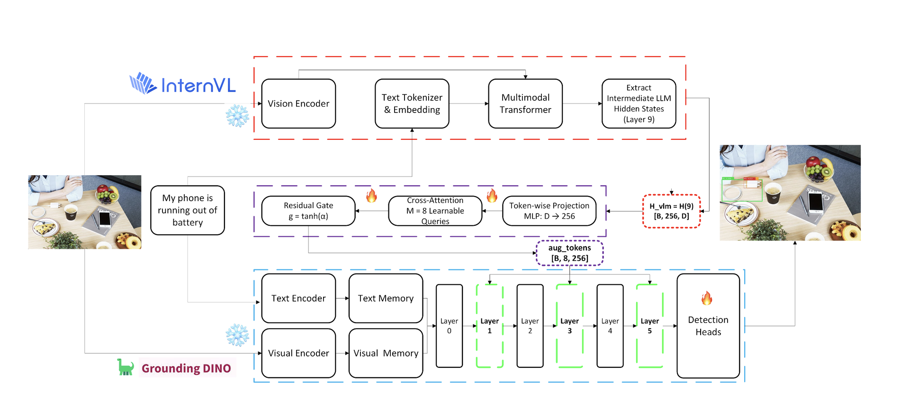
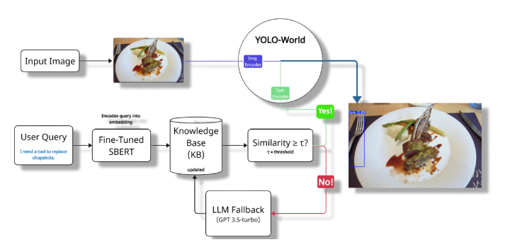
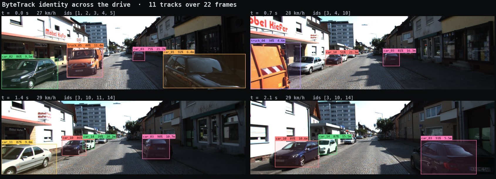
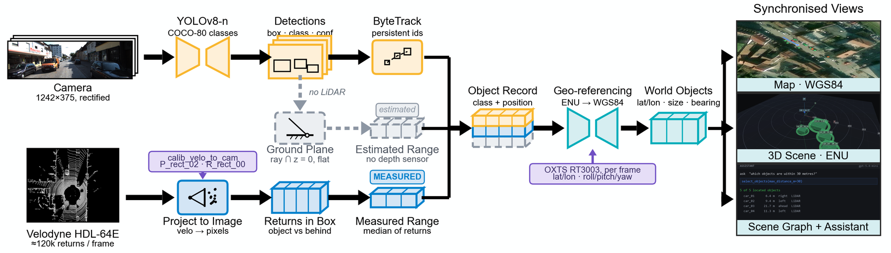
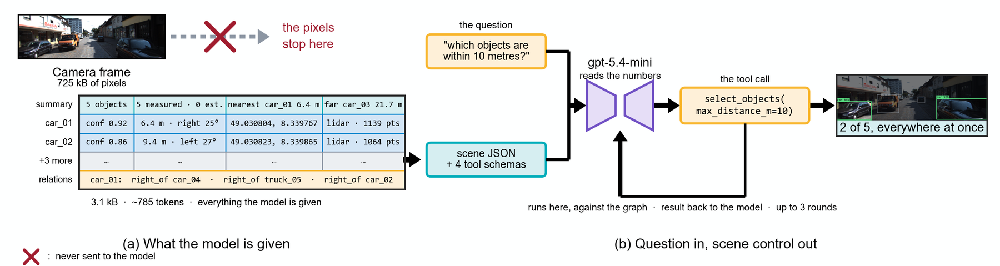

# Ibrohimjon Muminov

### Multimodal AI Engineer · Visual Grounding Researcher

I build AI systems that connect **language reasoning** with **visual perception**—so models can understand what a person means, decide what to look for, and localize it in the scene.

---

## Research at a glance

- **Current:** M.S. in Artificial Intelligence at Dongguk University, Seoul
- **Focus:** multimodal reasoning, vision-language models, visual grounding, and open-vocabulary detection
- **Goal:** make visual systems understand ambiguous, functional, and human-centered instructions—not only fixed object labels
- **Workflow:** semantic planning → candidate detection → visual reasoning → grounded decision

  

## Selected research

| Project | What it investigates | Evidence |
|---|---|---|
| **See-Think-Detect** | A three-stage visual-grounding framework that plans what to look for, proposes candidates with a frozen detector, and reasons over them before selecting the referent. | **85.3%** Acc@0.5 on RefCOCOg-UMD validation and **86.01%** on test; ACCV 2026 submission, code private during review. |
| [**ThinkDet**](https://github.com/ibrohimgets/thinkdet) | A lightweight adapter that injects query-conditioned InternVL features into frozen GroundingDINO through gated residual fusion. | **16.99% → 17.77%** hit@0.5 on a corrected affordance benchmark; includes positive and negative results. |
| [**Vague2Detect**](https://github.com/ibrohimgets/Vague2Detect) | Grounds vague, functional requests using Sentence-BERT, a commonsense knowledge base, YOLO-World, and an LLM fallback. | Evaluated on approximately **1,000 household-object images**; accepted at AIComPS 2025. |
| [**CommonsenseVision**](https://github.com/ibrohimgets/CommonsenseVision) | Combines YOLOv8, CLIP, LLaVA, and trait reasoning to detect objects from user intent and scene context. | Accepted at ASK 2025 (KIPS); Korean patent application filed. |

## How two of them work

### ThinkDet — an adapter, not a retrain

Both large models stay frozen. A small trainable block reads InternVL's
intermediate hidden states, projects them to 256 dimensions, compresses them into
eight learnable query tokens by cross-attention, and passes them through a
**zero-initialized residual gate** `g = tanh(α)`. At α = 0 the network is
*exactly* the original GroundingDINO, so any gain has to be earned rather than
inherited from extra capacity.

  

Those eight tokens are injected into the detector's decoder memory at layers 1, 3
and 5. The point is that the detector inherits the language model's reading of an
ambiguous request instead of matching a class name:

  

  Prompt: <em>“tool to eat with.”</em> The baseline's top box (left) straddles both utensils; ThinkDet's (right) picks one out.

### Vague2Detect — ask for a function, get an object

A fine-tuned Sentence-BERT encodes the request and looks it up in a commonsense
knowledge base, which hands a concrete class to YOLO-World. When nothing clears
the similarity threshold τ, a GPT-3.5 fallback proposes the class **and writes it
back into the knowledge base** — so the same question is answered locally next
time, and the system leans on the API less the more it is used.

  

  <em>“I need a tool to replace chopsticks”</em> → fork.

## Latest build — GeoDetect

A change of register: no paper and no training, just engineering.
[**GeoDetect**](https://github.com/ibrohimgets/geodetect-visual-intelligence)
reads a real KITTI drive — camera, Velodyne LiDAR, OXTS GPS/IMU and the rig's
calibration files — and works out where every detected object actually is on the
Earth, then lets you interrogate the scene in plain language.

  

  ByteTrack holds each object's identity as the vehicle moves — <code>car_03</code> is the same car at 21.7 m, 16.3 m, 10.7 m and 5.5 m. Every distance is measured by the LiDAR, not inferred.

The amber lane below decides **what** a thing is; the blue lane measures **where**
it is. The dashed lane is what happens when there is no depth sensor to ask — the
same detections, a flat-ground assumption instead of a measurement, and a label
that says so. Positions are tagged `measured` or `estimated`, and the two are
never quietly averaged.

  

The language model is a stage in that pipeline rather than a chat box bolted to
the side — and it is deliberately kept away from the pixels:

  

It never sees the image. It receives **3.1 kB of measurements** — classes,
confidences, distances, bearings, coordinates, spatial relations — and none of
the 725 kB of pixels they were measured from. It answers by emitting a tool call,
and that call runs *locally*, against the scene graph, before its result goes
back to the model.

Whether the geometry works is checkable rather than asserted: over 22 frames the
vehicle covers 17 m and a parked car's ego-relative position sweeps 16.5 m past
it, while its absolute WGS84 position holds to **0.70 m**.

## Publications and intellectual property

- **Learning to Ground Like Humans: Semantic Planning and Candidate Reasoning for Visual Grounding** — ACCV 2026, under review
- **Vag2Det: Handling Ambiguous Prompts in Knowledge-Based Open-World Detection** — AIComPS 2025, accepted
- **Commonsense-Guided Open-World Object Detection Using LLMs and Visual-Semantic Matching** — ASK 2025 (KIPS), accepted
- **Open-World Object Detection Using a Knowledge-Based LLM and Visual-Semantic Matching** — Korean patent application 10-2025-0070409, filed May 2025

## Technical focus

`Python` · `PyTorch` · `Transformers` · `Vision-Language Models` · `GroundingDINO` · `YOLO-World` · `CLIP` · `LLaVA` · `LoRA` · `OpenCV` · `Docker` · `FastAPI` · `Three.js` · `Leaflet`

## Let’s connect

I am interested in research collaborations and opportunities involving multimodal AI, visual grounding, open-vocabulary detection, and intelligent visual systems.

- Portfolio: [ibrohimgets.github.io](https://ibrohimgets.github.io/)
- CV: [download the current PDF](https://ibrohimgets.github.io/Ibrohimjon_Muminov_CV_2026.pdf)
- LinkedIn: [ibrohim-muminov-775650259](https://www.linkedin.com/in/ibrohim-muminov-775650259/)
- Email: [ibrohimuminov@gmail.com](mailto:ibrohimuminov@gmail.com)

  Seoul, South Korea · Language reasoning × computer vision

