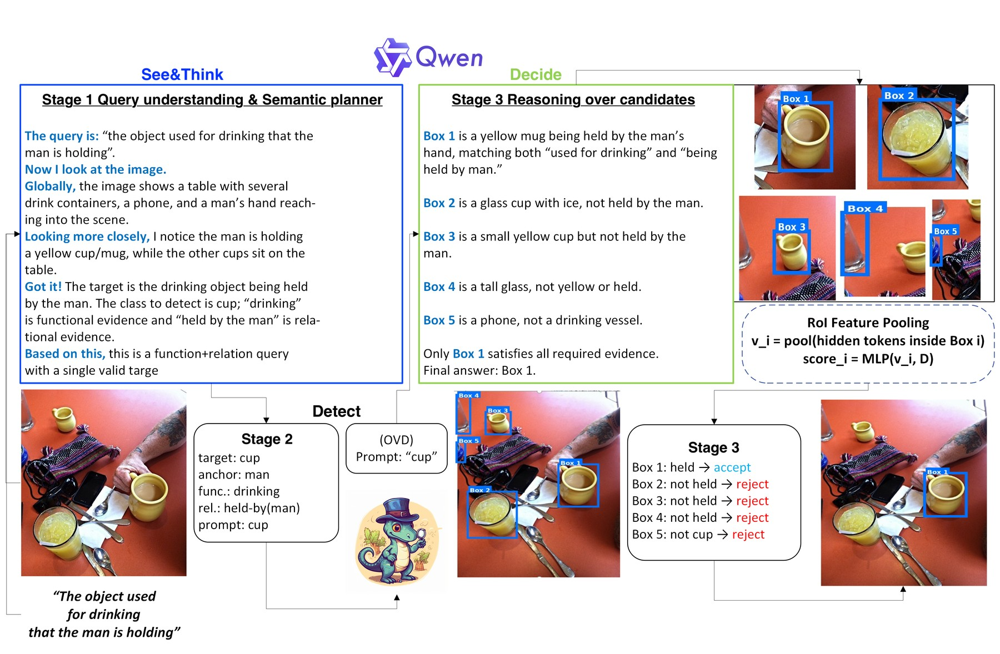
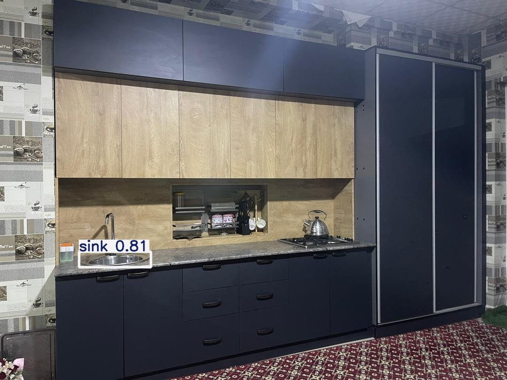

# Ibrohimjon Muminov

### Multimodal AI Engineer · Visual Grounding Researcher

I build AI systems that connect **language reasoning** with **visual perception**—so models can understand what a person means, decide what to look for, and localize it in the scene.

---

## Research at a glance

- **Current:** M.S. in Artificial Intelligence at Dongguk University, Seoul
- **Focus:** multimodal reasoning, vision-language models, visual grounding, and open-vocabulary detection
- **Goal:** make visual systems understand ambiguous, functional, and human-centered instructions—not only fixed object labels
- **Workflow:** semantic planning → candidate detection → visual reasoning → grounded decision

  

## Selected research

| Project | What it investigates | Evidence |
|---|---|---|
| **See-Think-Detect** | A three-stage visual-grounding framework that plans what to look for, proposes candidates with a frozen detector, and reasons over them before selecting the referent. | **85.3%** Acc@0.5 on RefCOCOg-UMD validation and **86.01%** on test; ACCV 2026 submission, code private during review. |
| [**ThinkDet**](https://github.com/ibrohimgets/thinkdet) | A lightweight adapter that injects query-conditioned InternVL features into frozen GroundingDINO through gated residual fusion. | **16.99% → 17.77%** hit@0.5 on a corrected affordance benchmark; includes positive and negative results. |
| [**Vague2Detect**](https://github.com/ibrohimgets/Vague2Detect) | Grounds vague, functional requests using Sentence-BERT, a commonsense knowledge base, YOLO-World, and an LLM fallback. | Evaluated on approximately **1,000 household-object images**; accepted at AIComPS 2025. |
| [**CommonsenseVision**](https://github.com/ibrohimgets/CommonsenseVision) | Combines YOLOv8, CLIP, LLaVA, and trait reasoning to detect objects from user intent and scene context. | Accepted at ASK 2025 (KIPS); Korean patent application filed. |

  

## Publications and intellectual property

- **Learning to Ground Like Humans: Semantic Planning and Candidate Reasoning for Visual Grounding** — ACCV 2026, under review
- **Vag2Det: Handling Ambiguous Prompts in Knowledge-Based Open-World Detection** — AIComPS 2025, accepted
- **Commonsense-Guided Open-World Object Detection Using LLMs and Visual-Semantic Matching** — ASK 2025 (KIPS), accepted
- **Open-World Object Detection Using a Knowledge-Based LLM and Visual-Semantic Matching** — Korean patent application 10-2025-0070409, filed May 2025

## Technical focus

`Python` · `PyTorch` · `Transformers` · `Vision-Language Models` · `GroundingDINO` · `YOLO-World` · `CLIP` · `LLaVA` · `LoRA` · `OpenCV` · `Docker`

## Let’s connect

I am interested in research collaborations and opportunities involving multimodal AI, visual grounding, open-vocabulary detection, and intelligent visual systems.

- Portfolio: [ibrohimgets.github.io](https://ibrohimgets.github.io/)
- CV: [download the current PDF](https://ibrohimgets.github.io/Ibrohimjon_Muminov_CV_2026.pdf)
- LinkedIn: [ibrohim-muminov-775650259](https://www.linkedin.com/in/ibrohim-muminov-775650259/)
- Email: [ibrohimuminov@gmail.com](mailto:ibrohimuminov@gmail.com)

  Seoul, South Korea · Language reasoning × computer vision

